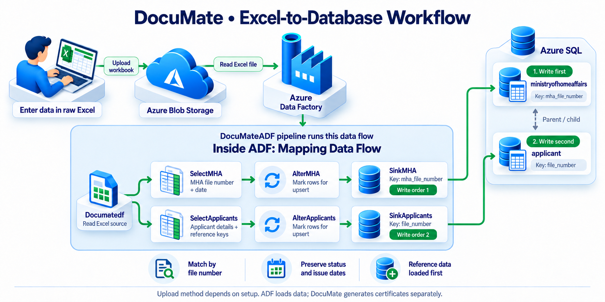

# DocuMate

Document automation and data validation for consular birth-registration certificates.

DocuMate replaces the manual copying of applicant details from Excel into Word certificates. It started as a Python script and grew into a modular tool supporting Excel, PostgreSQL and Azure SQL, with different document-generation methods for different workloads. An optional Azure Data Factory pipeline loads spreadsheet data into Azure SQL.


## The problem

Officers prepared certificates by copying applicant details into Word, one record at a time. Excel also held the processing status, so staff had to check missing details, track completed records and work through the backlog manually.

DocuMate brings document generation and status tracking into one workflow, with validation for the Excel versions and a shared database for the database versions and reporting.

## Impact

- **Operational use:** helped the Dispatch team clear approximately 88% of a pending backlog in one week (480 of 540 cases).
- **Benchmark:** DocuMate O processed 1,440 records in about 100 seconds. At the measured manual rate of 315 seconds per record, the equivalent manual workload is an estimated 126 hours.
- **Processing control:** successfully generated records are marked as `PRINTED`, so subsequent runs can select pending work.
- **Reporting:** Power BI can read the same PostgreSQL data used by DocuMate to report on processing volume and backlog.

The benchmark measures automated processing, not the full time needed for review, signing and dispatch.

## How it works

1. **Read pending records** from Excel, PostgreSQL or Azure SQL, depending on the selected version.
2. **Apply the version's checks.** Excel versions run the five-stage validation routine. Database versions use SQL filtering and database constraints; they do not run that same routine.
3. **Generate certificates** in a combined Word document using Python template rendering or Word Mail Merge.
4. **Update processing status** for successfully generated records in the source.
5. **Use the database for reporting**, without copying the records into a separate reporting spreadsheet.

The optional ADF route adds an ingestion step before the database workflow:

```text
Excel in Blob Storage → ADF → Azure SQL → DocuMate → Word certificates
                                            ↓
                                  Processing-status updates
```

ADF loads the records. DocuMate runs separately to generate the documents.

## Versions

| Version | Source | Document generation | Purpose |
| --- | --- | --- | --- |
| **v3** | Excel | `docxtpl` | Production Excel workflow with validation and merged output |
| **X** | Excel | Word Mail Merge | Batches of 250 records for large runs |
| **Y** | Excel | Word Mail Merge | One batch; suitable for smaller runs |
| **Z** | PostgreSQL or Azure SQL | `docxtpl` | Database workflow with polling for pending records |
| **O** | PostgreSQL or Azure SQL | Word Mail Merge | Database workflow with batches of 100 records |

The earlier v1 and v2 scripts established the proof of concept. The five maintained versions share the same modules and select a source and rendering engine through configuration.

In v3, X and Y, validation checks that data and a status column exist, selects pending records, and blocks generation when required fields are missing or file numbers are duplicated. Z and O have this application-level routine disabled and instead use the database's constraints and pending-record queries.

## Optional Azure Data Factory ingestion



The ADF pipeline reads Excel files from Azure Blob Storage and loads them into related Azure SQL tables. This extends the database workflow; Excel and PostgreSQL versions do not require ADF.

The mapping data flow writes MHA records first, followed by applicant records. It uses file-number keys to insert new records or update matching records. Processing status and issue dates are excluded from the write mapping, preserving those fields on existing records.

State and signing-authority reference data must already be loaded. The Python loader is a separate option: it populates all four tables and skips existing records, whereas ADF writes to the two tables below and can update matching rows.

Definitions are stored in [`adf/`](adf/) through Data Factory's Git integration. Saving definitions in Git and publishing them to a running factory are separate steps.

| Definition | Purpose |
| --- | --- |
| [Pipeline](adf/pipeline/DocuMateADF.json) | Runs the mapping data flow |
| [Data flow](adf/dataflow/DocumateDataFlow.json) | Selects columns and inserts or updates the two tables |
| [Excel dataset](adf/dataset/Documate_Excel.json) | Reads the workbook from Blob Storage |
| [Applicant dataset](adf/dataset/DS_Documate_DB.json) | Connects to the applicant table |
| [MHA dataset](adf/dataset/DS_Documate_MHA.json) | Connects to the MHA table |
| [Linked services](adf/linkedService/) | Blob Storage and Azure SQL connections |

Reconfigure storage, database connections and authentication for your environment before running the pipeline. The repository also contains a self-hosted runtime definition for local-file access; the committed Excel source uses Blob Storage.

## Quick start

Install the dependencies:

```bash
pip install -r requirements.txt
```

Check the installation and list the available versions:

```bash
python main.py --check
python main.py --list
```

Run the Excel-based production workflow:

```bash
python main.py v3
```

The Excel versions (`v3`, `x`, `y`) run from the synthetic workbook in `files/data/`. The Mail Merge versions (`x`, `y`, `o`) require Microsoft Word on Windows. Generated documents go to `files/output/`, which is intentionally ignored by Git.

## Modular structure

```text

├── main.py          command-line runner
├── flow/            validation, pipeline, status updates
├── sources/         Excel, Azure SQL and PostgreSQL readers
├── engines/         docxtpl and Word Mail Merge renderers
├── versions/        v3, X, Y, Z and O settings
├── setup/           paths, configuration, messages, UI
├── files/           synthetic data, templates, generated output
├── adf/             Azure Data Factory pipeline, dataflow and datasets
└── project/         documentation, schema and workflow diagram
```

To change a version, edit [the version registry](versions/registry.py). To change the workflow shared by every version, edit [the pipeline](flow/pipeline.py). Connection and file-path settings belong in [configuration](setup/config.py), while private values belong in `.env`.

## Database setup

Z and O use Azure SQL or PostgreSQL, chosen by `DOCUMATE_DB_BACKEND`. Create the
tables with the script for your database:

```bash
# Azure SQL (default)
sqlcmd -S YOUR_SERVER.database.windows.net -d YOUR_DB -U YOUR_USER -P YOUR_PASSWORD        -i project/database_schema/DocuMate_Data_Schema_AzureSQL.sql

# PostgreSQL
psql -h YOUR_HOST -U YOUR_USER -d YOUR_DB -f project/database_schema/DocuMate_Data_Schema.sql
```

Copy `.env.example` to `.env` and enter the database connection values. `.env` is ignored by Git; never place passwords or connection credentials in source files.

```text
DOCUMATE_DB_BACKEND=azuresql
DOCUMATE_DB_HOST=your-server.database.windows.net
DOCUMATE_DB_NAME=your-database
DOCUMATE_DB_USER=your-user
DOCUMATE_DB_PASSWORD=your-password
```

Leave `DOCUMATE_DB_PORT` unset and the backend's own port is used: 1433 for Azure
SQL, 5432 for PostgreSQL. Azure SQL also needs Microsoft ODBC Driver 18 installed
and your client IP allowed under the SQL server's Security -> Networking. Run
`python main.py --check` to see what was picked up.

Load the sample records with `python -m tools.seed_database --insert`; it writes
to whichever backend is selected.

## Further reading

- [Evolution and benchmarks](project/docs/EVOLUTION.md)
- [Template setup](project/docs/TEMPLATES.md)
- [Engineering decisions](project/docs/DESIGN_DECISIONS.md)
- [Modularisation map](project/docs/MODULARISATION.md)

## Author

**Angad Kadam**

[LinkedIn](https://linkedin.com/in/angad-kadam-03b606159) · [GitHub](https://github.com/angad08)
